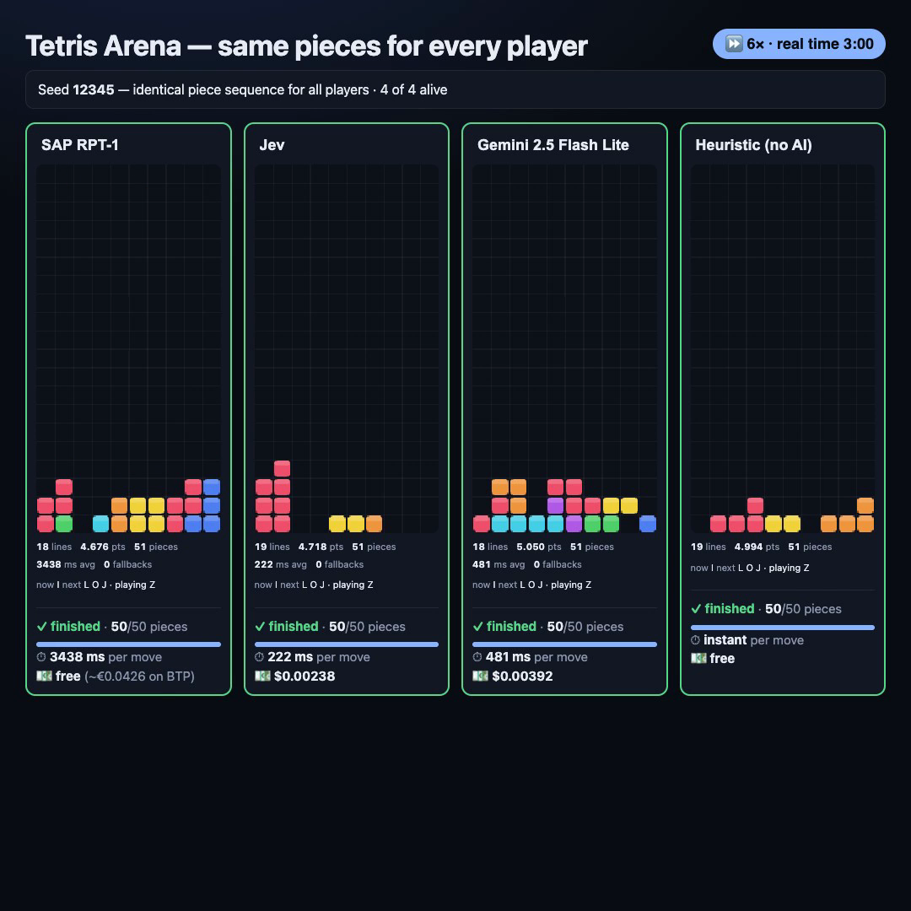

# Tetris Arena

**SAP-RPT-1 vs. Jev vs. any LLM vs. a 15-line heuristic: same pieces, same
candidate moves, live cost tracking.**

[](media/tetris-arena-50-pieces.mp4)

▶ [Watch the 40-second race](media/tetris-arena-50-pieces.mp4) (6× timelapse, 50 identical pieces per player)

Lately there have been plenty of demos of AI models playing Tetris. This project
asks what is actually going on behind them: how good the play is, how fast it
is, what it costs, and how much depends on the model rather than on what the
model is told. The answer turned out to be "less than you would think". A
hand-written heuristic and a well-briefed cheap model play as well as anything
else here.

---

## Contents

- [Quick start](#quick-start)
- [How the arena works](#how-the-arena-works)
- [The contestants](#the-contestants)
- [Results](#results)
- [Cost comparison](#cost-comparison)
- [How each model is asked: prompts and payloads](#how-each-model-is-asked-prompts-and-payloads)
- [How Jev was improved: the same model with three briefings](#how-jev-was-improved-the-same-model-with-three-briefings)
- [What the models were trained on](#what-the-models-were-trained-on)
- [Connecting the backends](#connecting-the-backends)
- [Recording a video](#recording-a-video)
- [Project layout](#project-layout)
- [Caveats](#caveats)
- [License](#license)

---

## Quick start

Requirements: Node.js 18+ and a modern browser. There is no build step and there
are no runtime dependencies.

```sh
git clone https://github.com/<you>/tetrisarena.git
cd tetrisarena
cp .env.example .env     # add the keys for the backends you want (see below)
node server.mjs          # → http://localhost:8787
```

Open <http://localhost:8787>, press **+ Add player** a few times, pick a backend
per player and press **Run**.

- **No keys at all?** Keyboard play and the local heuristic work without any.
  You can even open `index.html` straight from disk.
- **Keys stay on the server side.** They live in `.env`, which is git-ignored.
  The browser never sees them. A small local proxy (`server.mjs`) adds them to
  outgoing calls.
- **The proxy listens on `127.0.0.1` only**, so nobody else on your network can
  spend your credits through it. Set `HOST=0.0.0.0` only if you really need to
  expose it.

---

## How the arena works

```
            same seed → identical piece stream for every player
                                   │
                    ┌──────────────┴──────────────┐
                    │   js/features.js            │
                    │   enumerate legal placements│
                    │   + board features for each │
                    └──────────────┬──────────────┘
                                   │  the SAME top-N candidates
       ┌───────────────┬───────────┼────────────┬────────────────┐
   heuristic          Jev        SAP-RPT-1   any OpenRouter     you
  (local, 0 ms)   typed choice   table       chat model      (keyboard)
                                regression    (JSON reply)
       └───────────────┴───────────┴────────────┴────────────────┘
                                   │
                    chosen placement → hard drop → next piece
```

- **Fair comparison.** Every player gets the same seed, so the piece sequence is
  identical. That makes this a comparison of decisions, not of luck.
- **The game logic is ordinary JavaScript.** Rules, collision, scoring and
  rendering are all JS. Neither Jev nor RPT-1 is a runtime or generates code;
  the models only pick a move.
- **Same candidates for everyone.** All backends choose from the same shortlist
  of legal placements: the top 10 by the heuristic score by default, adjustable
  in the UI. They also see the same board features, so nobody has an information
  advantage.
- **The game never stalls.** Errors, timeouts and illegal answers fall back to
  the heuristic's move. Each fallback is counted and shown.
- **Live cost tracking.** Two side rails show calls, tokens or cells, billed
  spend, cost per piece and per line, and a projection to 1,000 pieces.

---

## The contestants

| Backend | What it is | What it gets per piece | What comes back |
| --- | --- | --- | --- |
| **Heuristic** (`heuristic`) | El-Tetris linear scoring ([Islam El-Ashi, 2011](https://imake.ninja/el-tetris-an-improvement-on-pierre-dellacheries-algorithm/)), six weighted board features | nothing (runs locally) | best-scoring placement |
| **Jev** (`jev`, `jev-lean`, `jev-2ply`) | [TypeSafe AI](https://typesafe.ai) "System One" decision model | a `state` object + a typed `choice` question whose options are the candidates | `{choice, confidence}`; it cannot answer illegally |
| **SAP-RPT-1** (`rpt1`) | [SAP's relational pretrained transformer](https://www.sap.com/products/artificial-intelligence/sap-rpt.html), a tabular foundation model | a **table**: one row per candidate, numeric feature columns, the target column marked `[PREDICT]`, plus labelled context rows | a predicted score per row, with a confidence interval and feature importances |
| **Any chat LLM** (`llm`) | any of the ~470 models on [OpenRouter](https://openrouter.ai) | the ASCII board + a numbered list of legal placements | `{"option": "option_N", "why": "…"}`, parsed tolerantly |
| **You** | keyboard | — | — |

The heuristic is the whole point of comparison. Its scoring rule is about 15 lines
(`js/features.js`):

```js
score = -4.50 * landingHeight + 3.42 * linesCleared - 3.22 * rowTransitions
        - 9.35 * colTransitions - 7.90 * holes - 3.39 * wellSums
```

Run alone, it survives more than 1,500 pieces (`node bench.mjs 3 1500`: about
599 lines, no top-out).

---

## Results

### The 50-piece race (the video)

Seed 12345, 50 identical pieces per player, 10 candidates per decision, 0
fallbacks for every player. Recorded on 2026-10-26.

| Player | Lines after 50 pieces | Time per move | Cost for 50 pieces | Per 1,000 pieces |
| --- | --- | --- | --- | --- |
| **Jev** (`jev-2ply`) | **19** | 222 ms | $0.0024 | **$0.05** |
| **Heuristic** | **19** | < 1 ms | free | **free** |
| SAP-RPT-1 (`sap-rpt-1.6`) | 18 | 3,438 ms¹ | free in playground (≈ €0.043 on BTP²) | ≈ €0.85² |
| Gemini 2.5 Flash Lite | 18 | 481 ms | $0.0039 | $0.08 |

¹ Almost entirely the free playground's mandatory request spacing (one call
every 3.5 s). The inference itself takes 0.6–1.2 s.
² Theoretical. Calculated from SAP's per-cell rate card at €1 per capacity
unit, see [cost comparison](#cost-comparison).

**How to read it.** On play quality this is a four-way tie: 18 or 19 lines is
within noise for 50 pieces. The players differ by orders of magnitude on speed
and cost instead. The heuristic matches the best model instantly and for free.

### The full field (20 pieces)

Seed 31337, 8 candidates, 0% fallbacks. Ranked by lines, then holes. Jev ran
here with its **original** prompt, before the
[prompt improvements](#how-jev-was-improved-the-same-model-with-three-briefings).

| Backend | Lines | Holes | Stack | Agreed with heuristic | Latency | Per 1,000 pieces |
| --- | --- | --- | --- | --- | --- | --- |
| `sap-rpt-1.6` | **7** | **0** | 3 | 95% | 3,371 ms | €0.68 (theoretical BTP) |
| `google/gemini-2.5-flash-lite` | **7** | **0** | **2** | 70% | 570 ms | $0.07 |
| `openai/gpt-oss-20b` | **7** | **0** | **2** | 70% | 7,861 ms | $0.09 |
| `openai/gpt-5-mini` | **7** | **0** | **2** | 70% | 5,311 ms | $0.84 |
| heuristic | 6 | 1 | 3 | 100% | **0 ms** | **free** |
| `anthropic/claude-haiku-5.5` | 6 | 1 | 4 | 50% | 3,389 ms | $0.36 |
| `jev` (original prompt) | 5 | 1 | 4 | 50% | **329 ms** | **$0.04** |
| `openai/gpt-5-nano` | 3 | 1 | 6 | 40% | 14,625 ms | $0.55 |

**Takeaways**

- **The top of the field ties on play and differs 12× in cost and 14× in
  latency.** The choice comes down to budget and speed.
  `gemini-2.5-flash-lite` is the best general-purpose pick: joint-best board,
  second-fastest and second-cheapest.
- **Bigger or "reasoning" models buy nothing here.** `gpt-5-mini` costs 12× as
  much as flash-lite for the same board. It also spent 87% of its output tokens
  on reasoning. `gpt-5-nano` is worst on every axis at once.
- **Jev is the cheapest and fastest by a wide margin.** Its typed contract never
  produced an illegal answer in any run. With the improved prompt it reaches
  heuristic-level play (see below).
- **RPT-1's 95% agreement with the heuristic is partly circular.** Its context
  rows are labelled with the heuristic's own score, so it is largely
  reproducing that function (see [what it was trained on](#what-the-models-were-trained-on)).

---

## Cost comparison

The three paid backends are billed in completely different units, which is the
main reason "which one is cheaper" is easy to get wrong.

| | Jev | Chat LLMs | SAP-RPT-1 |
| --- | --- | --- | --- |
| **Billing unit** | tokens (input; output free on OpenRouter) | input + output tokens, reasoning tokens included | **cells** (per 1,000 input cells / 1,000 predicted cells) |
| **Where the price comes from** | real `usage.cost` per call (OpenRouter) | real `usage.cost` per call (OpenRouter) | SAP rate card (SAP Note 3437766) × capacity-unit factor |
| **Typical payload per move** | ~850 input tokens | 600–1,000 input tokens + 100–2,000 output tokens | ~56 rows × 15 columns ≈ 840 cells, of which 8–10 are predicted |
| **Per 1,000 pieces (measured)** | **$0.04–0.05** | $0.07 (flash-lite) … $0.84 (gpt-5-mini) | **€0.63–0.85** on the cheapest tier, €10+ on Deep Context |
| **Free option** | — | — | the `rpt.cloud.sap` playground (rate-limited) |

**RPT-1 in detail.** SAP meters RPT-1 per 1,000 cells, not per token. A
**predicted cell costs about 103× an input cell**. That means widening the
context table is almost free, while asking for more predictions is not.

```
GenAI tokens   = inputCells/1000 × rate_in + predictedCells/1000 × rate_out
capacity units = GenAI tokens × 1.90385          (published constant)
EUR            = capacity units × your € per CU  (contract-specific; UI default 1)
```

| Model | GenAI tokens / 1k input cells | / 1k predicted cells | ≈ per 1,000 pieces |
| --- | --- | --- | --- |
| `sap-rpt-1-small`, `-1.5`, `-1.6` | 0.00020 | 0.02054 | **€0.63** |
| the same, `-large` / `tabpfn-3.5-plus` | 0.00055 | 0.07630 | €2.03 |
| `sap-rpt-1.6-large` (Deep Context) | 0.00275 | 0.38150 | €10.17 |

The game shows this live in the **SAP BTP, theoretical** panel. It is kept
strictly separate from billed spend, because the playground costs nothing.
`node sap-cost.mjs --eur-per-cu 0.9 --pieces 5000` runs the same maths on the
command line.

**In context.** At the cheapest tier, RPT-1 costs roughly 16× as much as Jev and
9× as much as flash-lite for this workload. That is the same order of magnitude,
but it is not free. Running the heuristic costs nothing at all.

---

## How each model is asked: prompts and payloads

### Chat LLMs: a system prompt plus a numbered list

```text
You are playing Tetris. You will be given the board and a numbered list of legal
placements for the current piece. Choose the one that keeps the stack alive
longest: clearing lines is good, burying empty cells under filled ones is very
bad, a flat low stack is better than a tall jagged one. Reply with JSON only, no
prose, no code fence: {"option": "option_N", "why": "<10 words max>"}
```

The user message contains the ASCII board (`#` filled, `.` empty) and one line
per candidate:

```text
option_3: rotate 1 quarter-turn(s), drop at column 4 -> clears 1 line(s),
creates no holes, stack height becomes 3, surface roughness 4, total holes 0
```

- **No model-specific parameters.** No `response_format` and no `temperature`
  are sent, so every model on OpenRouter can play.
- **Room for reasoning.** Reasoning models need output headroom: with a
  300-token cap, about 1 call in 3 came back empty, so the cap is 2,000.
- **Tolerant parsing.** The reply is accepted as fenced JSON, bare JSON, or a
  loose `option_N` in prose. It is then validated against the legal set.

### Jev: a state plus a typed question

Jev does not take a free-text prompt. It takes a `state` object and typed
`questions`. Each candidate becomes an option of a `choice` enum, so an illegal
move is impossible by construction. The request for the best variant
(`jev-2ply`) looks like this (values illustrative, two of ten options shown):

```json
{
  "model": "jev-latest",
  "state": {
    "board": "..........\n...##.....\n#.####.###",
    "board_note": "17 empty rows above this are omitted; \"#\" filled, \".\" empty, 10 columns",
    "active_piece": "T",
    "next_piece": "I",
    "current_max_height": 2, "current_roughness": 5, "current_holes": 0,
    "rows_of_headroom": 18,
    "all_options_open_new_holes": "none",
    "candidate_count": 10
  },
  "questions": {
    "placement": {
      "type": "choice",
      "instructions": "Choose where to drop the `active_piece`, thinking one piece ahead: each option also states what the best follow-up with the `next_piece` would achieve. Values are changes to the current board (see `current_*`). Decide in this order: (1) never open a new hole, and never leave the next piece unplaceable; (2) clear lines, counting the follow-up; (3) keep the stack low; (4) keep the surface flat. Only use a later rule to break a tie on the earlier ones.",
      "criteria": {
        "option_0": "rotation 2, column 1; clears 1; height +0 (to 2); roughness -2 (to 3); then the best I follow-up clears 1 and leaves height 1, holes 0",
        "option_1": "rotation 0, column 6; height +1 (to 3); roughness +1 (to 6); then the best I follow-up clears 0 and leaves height 3, holes 0"
      }
    }
  }
}
```

The answer has the form `{"placement": {"choice": "option_0", "confidence": 0.81}}`.

### SAP-RPT-1: a table, not a prompt

RPT-1 **receives no text instructions at all**. It is a tabular in-context
learner: it reads a table, sees example rows with known values, and predicts the
cells marked `[PREDICT]`. The Tetris move choice is therefore reshaped as a
**regression over a table** (`js/picker-rpt1.js`; values illustrative):

| row_id | piece | rotation | column | lines_cleared | landing_height | holes | holes_added | aggregate_height | max_height | bumpiness | row_transitions | col_transitions | well_sums | **placement_score** |
|---|---|---|---|---|---|---|---|---|---|---|---|---|---|---|
| ctx_0 | T | 0 | 3 | 0 | 1 | 0 | 0 | 4 | 2 | 3 | 22 | 14 | 1 | **-187.42** |
| ctx_1 | T | 2 | 7 | 0 | 2 | 1 | 1 | 6 | 3 | 7 | 26 | 19 | 4 | **-261.90** |
| … up to 240 context rows … | | | | | | | | | | | | | | |
| q_0 | S | 1 | 4 | 1 | 1 | 0 | 0 | 5 | 2 | 4 | 20 | 13 | 0 | **[PREDICT]** |
| q_1 | S | 0 | 0 | 0 | 2 | 1 | 1 | 7 | 3 | 6 | 24 | 17 | 2 | **[PREDICT]** |

- **Query rows.** There is one row per candidate placement (8–10 per move),
  with 13 numeric feature columns. The target column `placement_score` is set to
  `[PREDICT]`.
- **Context rows: the "training data" of the request.** These are placements
  whose score is already known. Before the game, the table is primed with a short
  heuristic self-play (8 pieces × 6 placements = 48 rows), deliberately spread
  from best to worst so the target column has real variance. After every move,
  the chosen placement is added. The table is capped at 240 rows per player.
- **The label is the heuristic's own score.** Each context row's
  `placement_score` is the El-Tetris value of that placement. RPT-1 therefore
  learns to generalise a known scoring function from examples. It does not
  discover a better one. Swap `labelFor()` for an outcome-based label (e.g.
  lines cleared over the next 10 pieces) if you want it to learn something new.
- **What comes back.** RPT-1 returns a predicted score per query row. The arena
  plays the highest. The cloud route also returns a **confidence interval** and
  **feature importances**, shown in the decision log as e.g.
  `predicted -253.9 · ci [-260, -240] · leaned on row_transitions 0.207`.

Request body, as sent to SAP AI Core (the proxy translates it for the
`rpt.cloud.sap` dialect):

```json
{
  "prediction_config": {
    "target_columns": [{ "name": "placement_score", "task_type": "regression", "prediction_placeholder": "[PREDICT]" }]
  },
  "index_column": "row_id",
  "rows": [ "...context rows first, then the [PREDICT] rows..." ]
}
```

There is **no fine-tuning and no training job**. All "learning" happens inside
the single request, from the context rows.

---

## How Jev was improved: the same model with three briefings

`js/picker-jev.js` registers three backends that call the **same model** with
the **same candidate list**. They differ only in how the situation is described:

| Variant | What changes |
| --- | --- |
| `jev` (original) | full 20-row board, absolute feature values per option, next-piece queue included but unusable, an extra "top-out risk" question |
| `jev-lean` | board **cropped** to the occupied rows; values as **deltas** from the current board; facts identical across all options **stated once** in `state` instead of repeated; an **explicit priority order**; queue dropped |
| `jev-2ply` | lean, plus **real lookahead**: for each candidate, the best follow-up with the next piece is simulated locally (< 1 ms) and reported |

The original instruction was:

> *Pick the placement that keeps this Tetris stack survivable: prefer clearing
> lines, never bury a cell under a filled one, keep the surface flat and the
> stack low.*

The lean version replaced it with a **ranked** rule set:

> *Decide in this order: (1) never open a new hole — a covered empty cell is the
> worst outcome; (2) clear lines; (3) keep the stack low; (4) keep the surface
> flat. Only use a later rule to break a tie on the earlier ones.*

**Result over 3 seeds × 40 pieces (120 decisions per variant, 0% fallbacks):**

| Variant | Lines | Buried holes | Stack height | Agreed with heuristic | Latency | Cost per line |
| --- | --- | --- | --- | --- | --- | --- |
| heuristic (reference) | 14.3 | 0.0 | 3.7 | 100% | 0 ms | free |
| **`jev-2ply`** | **14.3** | **0.0** | **3.0** | 72% | 292 ms | **$0.00012** |
| `jev-lean` | 11.3 | 2.0 | 6.7 | 61% | 295 ms | $0.00012 |
| `jev` (original) | 9.0 | 8.3 | 9.0 | 47% | 300 ms | $0.00016 |

- **Buried holes went from 8.3 to 2.0 to 0.0.** Simply ranking "never open a
  hole" first removed three quarters of them. The lookahead removed the rest.
- **Lines went from 9.0 to 14.3 (+59%)**, matching the heuristic, with a lower
  stack than the heuristic keeps.
- **Latency is unchanged** and 2-ply is the **cheapest per line**, because it
  clears more lines per call.
- **The lesson is about information, not wording.** The original prompt spent
  81% of its board on empty rows, repeated facts that were the same for every
  option, and withheld the one thing needed to judge a move: what it leads to.
  Agreement with the heuristic rose (47% → 72%) but never reached 100%, so Jev
  plays at heuristic level through its own choices, not by imitating it.

Reproduce: `PIECES=40 SEEDS=1,2,3 node shootout.mjs heuristic jev jev-lean jev-2ply`

---

## What the models were trained on

| Model | Architecture | Training data | Trained on Tetris? |
| --- | --- | --- | --- |
| **SAP-RPT-1** | Tabular in-context learner: transformer over rows *and* columns, with column names and cell values embedded by a background language model. Introduced as **ConTextTab** ([Spinaci et al., NeurIPS 2025](https://arxiv.org/abs/2506.10707)), which builds on the TabPFN line of work. | The open research checkpoint [`SAP/sap-rpt-1-oss`](https://huggingface.co/SAP/sap-rpt-1-oss) was trained on **T4**, a subset of the **TabLib** corpus of real-world tables. Earlier table-native ICL models (TabPFN) were pretrained on synthetic tables only; ConTextTab's point is to learn from real tables, with their semantics. SAP has **not published** the training data of the hosted `sap-rpt-1.5` / `1.6` models used here. | **No.** It has never seen Tetris. Everything it knows about this task comes from the context rows in each request. |
| **Jev** | Not published. Outside observers suspect a transformer built on an open-weight LLM; TypeSafe has not confirmed this. | According to TypeSafe, trained with **RLCD (Reinforcement Learning for Calibrated Decisions)**, which optimises for confidence scores that match how often answers are right, and reportedly **entirely on synthetic data**. There is no technical paper and no independent validation yet ([overview](https://www.digitalocean.com/resources/articles/what-is-jev)). | No indication of it. |
| **Chat LLMs** | General-purpose language models. | Large-scale text and code, plus instruction tuning; reasoning models are additionally trained with RL. | No. They reason about the text description of the board. |
| **Heuristic** | Six-feature linear function. | **Not trained in this project.** The weights are the published El-Tetris values. | It *is* a Tetris algorithm. |

**Why this matters for the results.** None of the models were trained on Tetris
or fine-tuned for it. All of them are told the same features the heuristic
uses. RPT-1 is additionally shown examples labelled by the heuristic. It is
therefore not surprising that the best any of them achieves is
heuristic-level play.

---

## Connecting the backends

All keys go into `.env` (copy it from `.env.example`). `GET /api/health` shows
which routes are live.

### Jev

| Route | Key in `.env` | Endpoint | Default model |
| --- | --- | --- | --- |
| OpenRouter | `OPENROUTER_API_KEY` | `openrouter.ai/api/v1/systemone` | `~typesafe/jev-latest` |
| Native | `TYPESAFE_API_KEY` | `api.typesafe.ai/v1/systemone` | `jev-latest` |

### Chat LLMs

`OPENROUTER_API_KEY` also powers every chat model. The model list is fetched
live from OpenRouter (`/api/models`) with prices, so no model id is hardcoded.

### SAP-RPT-1

RPT-1 is **not** on OpenRouter. There are three routes:

1. **`rpt.cloud.sap` playground API, free.** This is the easiest. Create a token
   in the [playground](https://rpt.cloud.sap) and set `SAP_RPT_TOKEN`. It is
   rate-limited to a burst of ~5 requests per ~15 s and 1,000 requests per
   ~50 min. The proxy therefore spaces calls 3.5 s apart
   (`SAP_RPT_MIN_INTERVAL_MS`), so you get **about one move every 3.5 s**.
2. **SAP AI Core on BTP.** Set `AICORE_AUTH_URL`, `AICORE_CLIENT_ID`,
   `AICORE_CLIENT_SECRET`, `AICORE_BASE_URL` and `RPT1_DEPLOYMENT_ID` from your
   service key. The proxy does the OAuth exchange. The extended service plan is
   required.
3. **Open weights, local.** Serve
   [`SAP/sap-rpt-1-oss`](https://huggingface.co/SAP/sap-rpt-1-oss) behind the
   same `/predict` contract and point `AICORE_BASE_URL` at it. The checkpoints
   are licensed for research use only.

> **Tip:** the playground key also works outside the game. Hand it to an AI
> coding assistant together with your own CSV and try RPT-1 on a real
> business use case.

---

## Recording a video

`tools/record-video.mjs` records the square race video shown above. It
configures four players, freezes each one after `PIECES` pieces (so slow
backends are compared on the same pieces, not the same wall-clock time), adds a
title and a results card, and encodes an MP4.

```sh
npm i -D playwright                 # once; uses your installed Google Chrome
brew install ffmpeg                 # or any ffmpeg with libx264
node server.mjs &                   # the arena must be running
PIECES=50 node tools/record-video.mjs   # → media/tetris-arena.mp4 (+ .results.json)
```

---

## Project layout

```
index.html              markup + styling; cost rail | arena | cost rail
js/tetris.js            engine: 7-bag, rotation, collision, hold, ghost, scoring, top-out rules
js/features.js          placement enumeration + board features + El-Tetris weights (shared by ALL backends)
js/pickers.js           backend registry + heuristic
js/picker-jev.js        Jev: three prompt variants
js/picker-rpt1.js       SAP-RPT-1: table builder, context memory, prediction parsing
js/picker-llm.js        any OpenRouter chat model
js/sap-pricing.js       RPT-1 cell rate card + capacity-unit maths
js/arena.js             players, run loop, standings, cost ledger
js/render.js            canvas drawing
js/main.js              UI wiring, cost rails, keyboard
server.mjs              static server + key-holding proxy: /api/{models,llm,jev,rpt1,health}
bench.mjs               headless heuristic benchmark (no network)
shootout.mjs            headless head-to-head: lines, holes, latency, real cost
sap-cost.mjs            CLI: RPT-1 cost per piece / per game for every variant
tools/record-video.mjs  square race video for social posts
media/                  race video + poster
```

Controls: `←` `→` move · `↑`/`x`/`z` rotate · `↓` soft drop · `space` hard
drop · `c` hold · `p` run/pause · `r` reset.

---

## Caveats

- **Small samples.** The headline runs are 20–50 pieces on one seed, and the
  prompt study is 120 decisions per variant. Lines cleared is the noisiest
  metric at that length; holes and stack height are steadier. For a firmer
  ranking run `PIECES=60 SEEDS=1,2,3 node shootout.mjs heuristic jev-2ply rpt1 google/gemini-2.5-flash-lite`.
- **Only the heuristic is proven over a long game** (more than 1,500 pieces).
  None of the models has been shown to survive that long.
- **RPT-1 is measured through the free playground.** Its latency reflects the
  playground's rate limit, not the model, and its euro costs are theoretical.
- **Prices and models change.** All numbers are from October 2026 and come from
  OpenRouter's billed `cost` field or SAP's published rate card.
- **Not affiliated with SAP, TypeSafe AI, OpenRouter, Google or any other
  provider.** All product names belong to their owners.

---

## License

[MIT](LICENSE). Backends call third-party APIs under their own terms. The
SAP-RPT-1 open-weights checkpoint is licensed for research use only.
